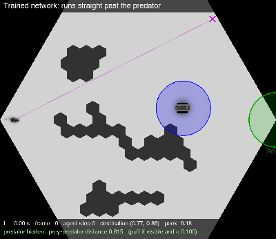
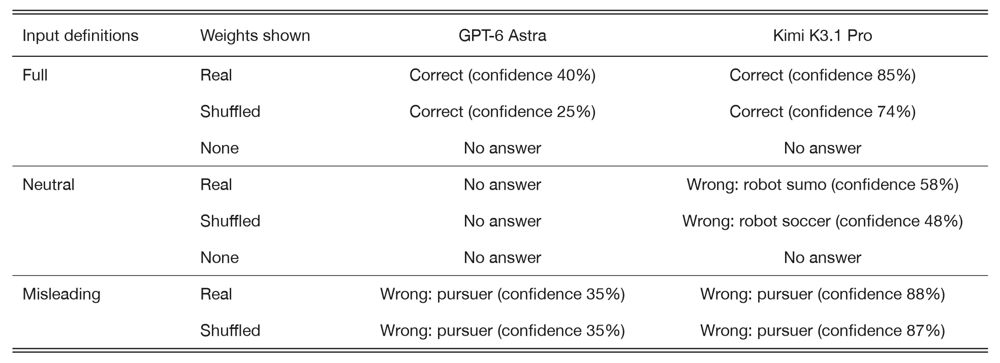
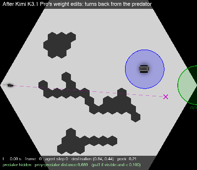
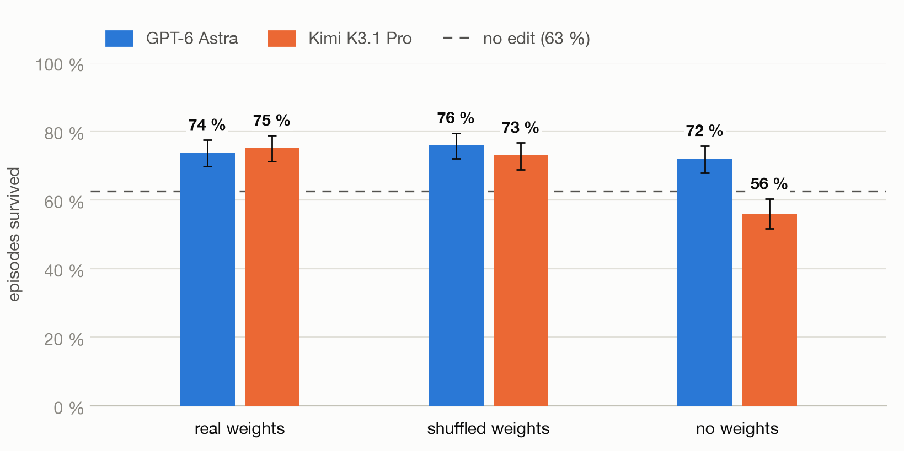
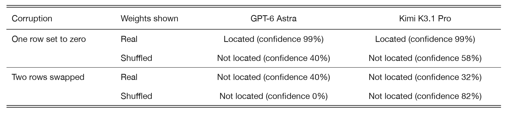

# Do LLMs read the weights?

*By [YuqingYang-2238](https://github.com/YuqingYang-2238), November 2026*

A recent post, [Sparks of Weight-Space Programming](https://rikiyat.github.io/blog/weight-space-programming/) by Takehi,
Teoh, Zhang and Khattab, makes a striking claim: a language model can read the raw weights of a neural network, as
plain text, and tell you what the network does. It can even repair a failing network by writing new weights by hand.

I wanted to see that on a problem of my own. I work with a small network that plays a predator-prey game. It controls a
simulated mouse that has to cross an arena while a robot predator hunts it. The network has a flaw that real mice do
not have. Biological mice are wary of the predator. My trained agent is not: when the predator stands in plain view on
its route, it runs straight past and gets caught.

<p align="center"></p>
<p align="center"><em>The misalignment: the trained agent sees the predator ahead and runs through its reach anyway.</em></p>

So I replicated two of the post's experiments on this network and added a third:

1. **Identify the game.** Show the model every weight and ask which game the network was trained on.
2. **Fix the failure.** Ask the model to close that gap in cautiousness by editing the weights.
3. **Find the planted bug.** Corrupt the weights myself and ask the model to find the damage.

The first two worked. Models named the game, and their hand-written edits raised the mouse's survival rate from 63 %
to 75 %. Then I asked the question this post is about: did the weights have anything to do with it?

**The short version.** The models do read the numbers: they quote weights and positions accurately, and one of them
did exact arithmetic on 288 of them. But the results do not depend on the numbers. When I shuffled every weight into
noise, the game was still identified and the fix worked just as well. What decides the answers is the text around the
weights. When I changed what the prompt says the inputs mean, the answers followed the text, even against the real
weights.

## The setup

The game is a simulated version of a mouse-versus-robot experiment. The prey starts on the left of a hexagonal arena
with obstacles and has to reach a goal on the right. A slow predator wanders around and heads for the prey whenever it
has line of sight. Coming within its reach is a capture, and an episode counts as **survived** only if the prey reaches
the goal without one. The trained network survives 313 of 500 episodes, or 63 %.

The network is tiny: 14 inputs, 3 actions and 16,678 weights. These are the weights of the policy, the complete path
from what the mouse observes to what it does. A prompt first defines the inputs and actions in words, then asks a
question, then lists every one of those weights, rounded to three decimals:

```
E1 (encoder layer 1 weights), shape 14 x 64: one line per row (row i = input i), 64 values per line
0.000 0.038 -0.059 -0.027 0.031 0.005 0.009 -0.021 -0.090 0.034 0.081 -0.075 0.110 -0.049 0.061 ...
```

That is about 114,000 characters of numbers in one message. The model gets no tools and one response. One thing the
model is told but not shown: when the mouse acts, a planner combines the policy with a dynamics model, a reward model
and five value models that were trained alongside it. Those are not in any prompt and cannot be edited. I used GPT-6
Astra and Kimi K3.1 Pro throughout, and five more models on the very first prompt. The whole study is 38 answers and
cost $25. More on the game and the network is in [docs/setup.md](docs/setup.md).

## Two things I changed

Every experiment below follows the same pattern: first the prompt as it is, then the same prompt with one thing
changed. Two of those changes need a short explanation.

**The weight block.** With *real weights*, the prompt lists the network's actual weights. With *shuffled weights*,
every tensor's values are randomly permuted within that tensor, so the numbers and shapes are the same but all
structure is gone. With *no weights*, the block is replaced by a single line saying the weights are not shown. Nothing
else in the prompt changes.

**The input definitions.** Every prompt contains a list that says what each of the 14 inputs and 3 actions is. In
Experiment 1, where the game is never named, that list is the only place where the prompt tells the model what the
numbers stand for, and it is what I varied there. The *full* version gives each input
its meaning without ever naming the game. The *neutral* version deletes the meanings and keeps only the ranges. The
*misleading* version keeps the full text but reverses the roles, so that the fleeing mouse is described as the pursuer.
Here is one input in all three, slightly shortened:

```
full         input 7   1 on a step in which the other agent made contact with the controlled agent, otherwise 0
neutral      input 7   0 or 1
misleading   input 7   1 on a step in which the controlled agent caught the other agent, otherwise 0
```

One more term. The prompts of Experiments 1 and 3 ask the model to end with a **confidence** between 0 and 100 %.
When I report one, it is the number the model wrote about its own answer, not a measured accuracy.

## Experiment 1: identify the game

The prompt gives the full input definitions and the real weights, never names the game, and asks: *which game was this
network trained on? Work from the weights.* The right answer is a predator-prey evasion game with the agent as the prey.

Five of seven models got it:

| Model | Game named | Confidence | |
|:--|:--|:--|:--|
| Kimi K3.1 Pro | hide-and-seek / pursuit-evasion, agent as the evader | 85 % | correct |
| DeepSeek V4 Pro | predator-prey pursuit-evasion, agent is the prey | 80 % | correct |
| GPT-6 Astra | cat-and-mouse escape, predator-prey reach-avoid | 40 % | correct |
| Claude Opus 5.5 | tag, played as the evader | 35 % | correct |
| Claude Haiku 5.5 | pursuit-evasion, reach a target while avoiding the chaser | 30 % | correct |
| Grok 4.7 | hide-and-seek, agent as the seeker | 60 % | wrong role |
| Gemini 4 Argon | ran out of output budget while reasoning | - | no answer |

Their answers are full of quoted weights and remarks about which inputs matter. It looks like reading. But the input
definitions already mention an agent, another agent that is only visible in line of sight, a target and a contact
flag. How much of "pursuit-evasion" do you need the weights for?

**Changing the weights.** With no weights, both Astra and Kimi refuse to name a game. With shuffled weights, both
name the right game again, Kimi at 74 % confidence instead of 85 %, Astra at 25 % instead of 40 %. And they describe
structure in the noise. Astra, on the shuffled prompt:

> **1: own y.** Largest magnitude 1.286, the outstanding E1 coefficient: `E1[1,62] = -1.286` ... Exceptionally strong,
> concentrated dependence of the first preactivations on vertical position.

That entry really is -1.286 in the shuffled prompt, where it landed by chance. I checked every weight Astra cites by
position: all 17 match the shuffled prompt, and none matches the real network. The reading is accurate. It just is not
what the answer rests on.

**Changing the input definitions.** If the definitions carry the answer, then changing them should change the answer,
with the real weights sitting right there.

<p align="center"></p>
<p align="center"><em>Each cell is one model's answer: whether the game it named is correct, and the confidence it stated. "Wrong: pursuer"
means it took the prey for the chaser. The misleading definitions were not run without weights.</em></p>

With the meanings stripped, Astra says the game cannot be identified. Kimi commits to robot sumo from the real weights,
and to robot soccer when the same weights are shuffled. With the misleading definitions, both models call the prey a
pursuer. Kimi does so at 88 % confidence, slightly more than the 85 % it gave the truth. Neither notices any tension
with the weights.

**What this shows.** The answer follows the input definitions and ignores the weights. Across the ten answers with changed
definitions, not one moved toward the true game because of the numbers. The full account is in
[docs/identify_game.md](docs/identify_game.md).

## Experiment 2: fix the failure

This is the experiment I cared about most. The prompt names the game, shows the failure above step by step, lists the
weights, and asks the model to edit them so that the prey survives more often. The edits are written in a small text
format, applied to the network, and scored on 500 new episodes.

Astra mostly scaled and zeroed whole columns of the output layer, and it zeroed one single weight:

```
P3[:, 0] *= 0.20
P3[:, 1] *= 0.50
P3[85, 1] = 0
P3[:, 2] = 0
...
```

That single weight was well chosen. Astra had noticed that hidden unit 85 carries the largest weight into the
y output, -1.116, and it does.

Kimi did something more surprising. It wrote out two full columns of 96 numbers each. When I checked them, both were
*exact* combinations of the old columns, to the last digit: the new column 1 is the old column 1 plus half of column 2,
and the new column 0 is column 0 minus 0.9 times column 1 minus 1.5 times column 2. It had read 288 weights and done
the arithmetic by hand. Column 2 drives an output that jumps when the predator comes into view, so these sums wire
that signal into the prey's steering.

Both edits worked. Survival rose from 313 of 500 (63 %) to **369 (74 %)** with Astra's edits and **376 (75 %)** with
Kimi's.

<p align="center">


</p>
<p align="center"><em>Before and after Kimi's edits. On the right, the predator comes into view just ahead, and the prey turns back,
circles the obstacle and reaches the goal. I picked this as the clearest of 100 recorded episodes, of which the edited
network survived 81.</em></p>

An LLM had made my agent more cautious by editing its weights as text. But look again at Astra's edit. Apart from
that one entry, it does not depend on any weight value: `P3[:, 1] *= 0.5` does the same thing whatever numbers are in
that column.

**Changing the weights.** I gave both models the same prompt with shuffled weights, and with no weights, and applied
whatever edits they wrote to the *real* network. An edit that depended on the values the model saw should now do
damage.



*Share of 500 episodes survived after each model's edits were applied to the real network, with 95 % intervals. The
dashed line is the network with no edit.*

It did no damage. Real against shuffled is a difference of 2 points in either direction, well inside the noise
(p = 0.42 and 0.43). Astra wrote whole-column edits in all three prompts, and the single-weight step only with the real weights. Kimi,
which had computed from the real weights, did not try that on the shuffled ones. It wrote three short statements and
did just as well. The one outlier is Kimi with
no weight block at all: it wrote huge bias shifts and made the network worse than leaving it alone. A block of numbers,
any numbers, kept its edits moderate.

**Changing the evidence.** If the fix does not come from the weights, it must come from the recorded failure. That
record lists, at every step, what the network received, what it output by itself, and what action was executed. So I
kept the real weights and removed parts of the record. These are smaller runs of 100 episodes, where the unedited
network survives 67 and differences of about 10 are noise.

| The failure record shows | GPT-6 Astra | Kimi K3.1 Pro |
|:--|:--|:--|
| inputs, the network's own outputs, the executed action | 77 / 100 | 79 / 100 |
| inputs and the executed action | 69 / 100 | 69 / 100 |
| inputs and the executed destination only | not run | 41 / 100 |

Without the network's outputs in the record, the edits are not measurably better than no edit. With even less, Kimi's edit made
the network clearly worse. The real weights were in all three prompts.

**What this shows.** The fix is real, and my agent did become more cautious. Both models used the real weights when
they had them. But they did equally well without them, and not measurably better than no edit once the recorded outputs were
removed. The fix
was worked out from the behaviour I showed them, not from the weights. The full account is in [docs/fix_failure.md](docs/fix_failure.md).

## Experiment 3: find the planted bug

Both experiments so far left the model a way around the weights. A fair test needs a question whose answer exists
nowhere else. So I corrupted one tensor of the trained network. The prompt describes the game, lists the corrupted
weights, and says only that *exactly one of the 18 tensors was deliberately corrupted: find it and undo it.* No
episode, no outputs, no hint about where.

I tried two corruptions. In the first, one row of the first layer is set to zero, which leaves 64 weights reading
0.000. In the second, two rows of the first layer are swapped, which leaves every value in place and only exchanges
their positions. As a control, each was also shown with the corrupted values shuffled.

<p align="center"></p>
<p align="center"><em>"Located" means the weights the model's edit rewrote are the corrupted ones. The confidence is the one the model
stated for its own diagnosis.</em></p>

Both models find the zeroed row at once, with 99 % confidence, and rewrite exactly its 64 weights. When the same values
are shuffled, so that the zeros are scattered, neither finds it. This is the one place in the whole study where the
real weights made a difference.

But a row of zeros is something you see, not something you work out. The swap is different. Every value is still
there, and noticing it means relating two rows of weights to what their inputs mean. Neither model finds it, and their
guesses look the same for real and shuffled weights. Kimi was 82 % confident that a single entry of the shuffled block
was the culprit: `E1[1,62]`, the same -1.286 that Astra had singled out in Experiment 1.

**What this shows.** With only the numbers to go on, the models find what is visible at a glance and miss what has to
be worked out. The full account is in [docs/planted_bug.md](docs/planted_bug.md).

## What I take from this

**Reading is not needing.** Both models transcribe weights faithfully from a 114,000-character prompt. Given the real
weights, Astra picked out the largest weight in a column and Kimi did arithmetic on 288 of them. The results were the
same without any of that. So quoting the weights, or even computing with them, is no evidence that an answer depends
on them.

**The text decides.** The game is identified from the input definitions. The fix is derived from the recorded
behaviour. Shuffle the weights and both survive. Change the text and the answer changes with it.

**The weight block works as permission.** Without it, the models decline or over-edit. With any block, real or noise,
they answer with confidence and describe structure that is not there.

**Run the shuffled control.** If you are testing whether a model understands a network's weights, a correct answer
means little until the same prompt with shuffled weights has been shown to fail. Mine kept succeeding.

I would still call what Kimi did in Experiment 2 weight-space programming. It changed the behaviour of a network on
purpose by writing numbers, and my mouse is more careful for it. It just did not need to read the network to do it. What it
needed was what I had told it about the network: what the numbers mean and how the mouse behaved.

## Caveats

There is one answer per condition, so the confidences are single samples. Only two models were used after the first
result. The models saw the policy only, about 3 % of the trained agent's parameters. The runs with less evidence in Experiment 2 are single 100-episode runs, one of them answered by Kimi only, and
they have no shuffled control. Shuffling keeps each tensor's set of values, so it tests positions, not magnitudes.
Experiment 3 reports whether the bug was located, not whether the repaired network survives again. And this is one
small network in one game.

## In this repo

This repo shows results. It holds every prompt exactly as sent and every answer exactly as received, but no code, no
trained checkpoint and no game.

- `lm_prompts/identify_game/`, `lm_prompts/fix_failure/`, `lm_prompts/planted_bug/`: the prompts. File names say what
  the prompt contains, for example `identify_game/neutral_inputs__shuffled_weights.txt`.
- `lm_prompts/responses/<experiment>/<prompt name>/<model>.md`: the answers, with reasoning traces and costs.
- `results/summary.csv`: one row per condition, with the numbers behind every table and figure.
- [docs/setup.md](docs/setup.md), [docs/identify_game.md](docs/identify_game.md),
  [docs/fix_failure.md](docs/fix_failure.md), [docs/planted_bug.md](docs/planted_bug.md),
  [docs/methods.md](docs/methods.md): the details.

## Acknowledgements

The idea, the two replicated experiments and the prompt format come from
[Sparks of Weight-Space Programming: LLMs can natively read & write neural network weights](https://rikiyat.github.io/blog/weight-space-programming/)
by Rikiya Takehi, Jayden Teoh, Alex Zhang and Omar Khattab, and its
[experiment logs](https://github.com/RikiyaT/lm_understand-logs). The network was trained with
[TD-MPC2](https://github.com/nicklashansen/tdmpc2) (Hansen, Su, Wang), using the code in
[tmdpc2_with_mice](https://github.com/YuqingYang-2238/tmdpc2_with_mice). The game is a simulated version of the cellworld
mouse-versus-robot experiments.

No license has been chosen for this repo yet.
