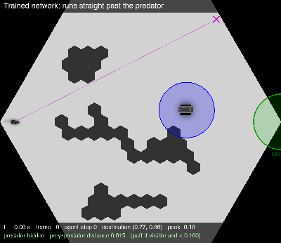
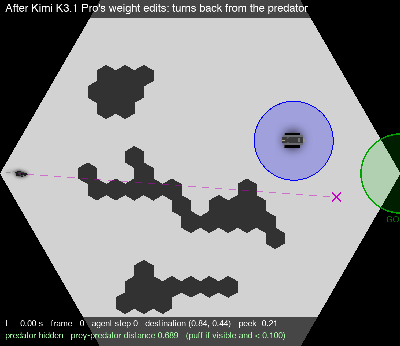
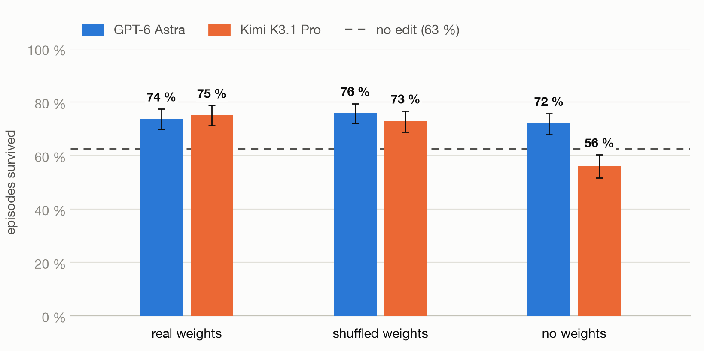

# Experiment `fix_failure`: fix the failure by editing the weights

**Task put to the model:** "Change the network's weights by hand so that the prey survives as often as possible."

The fix prompt ([`lm_prompts/fix_failure/real_weights.txt`](../lm_prompts/fix_failure/real_weights.txt)) names the game and its rules,
describes the network and the planner, reports the current result (67 of 100 episodes survived), and shows one recorded
failure step by step: the predator is in plain view, almost standing still, on the way to the goal, and the prey runs
past it inside the capture radius. For every decision step the trace lists the observation, the executed action, and
what the network outputs by itself. The prompt ends with the same 18 tensors as the identify prompt.

The model answers with an `edits` block, a small fixed text format:

```edits
b3[0:3] = [0.5, 2.0, -1.0]     # explicit values along one range
P3[7, 0:3] = 0                 # fill
P2[:, 3] *= 0.5                # scale a block (also += and -=)
ZERO b2                        # set a whole tensor to 0
```

The last block of an answer is applied to the network, and the edited network is scored with the planner. No tools, no code, no feedback: one response.



## 2a. The fixes

| network | edits | survived / 500 | 95 % interval | survived / 100 |
|---|---|---|---|---|
| original | - | 313 (62.6 %) | 58.3 to 66.7 % | 67 |
| GPT-6 Astra | `P3[:,0] *= 0.20`, `P3[:,1] *= 0.50`, `P3[85,1] = 0`, `P3[:,2] = 0`, `P3[:,3:6] = 0`, new `b3` | **369 (73.8 %)** | 69.8 to 77.5 % | 77 |
| Kimi K3.1 Pro | explicit 96-value lists for `P3[:,0]` and `P3[:,1]`, new `b3[0:2]` | **376 (75.2 %)** | 71.2 to 78.8 % | 79 |

Both improvements over the original are significant (two-proportion test: Astra +11.2 points, 95 % interval +5.5 to
+16.9; Kimi +12.6 points, +6.9 to +18.3; p < 0.001 for both). Every episode still reaches the goal; the edited
networks take a detour around the predator (mean episode length 7.0 and 11.2 steps against 6.0).



*The network with Kimi's edits in a new episode: the predator comes into view 0.24 ahead at t = 1.65 s, the prey turns
back, circles the obstacle above and reaches the goal without a capture (23 decision steps, closest approach 0.17).
This episode was picked as the clearest of 100 recorded ones, of which the edited network survived 81.*

Kimi's edit is a computation on the weights it was shown. Both of its new columns are exact combinations of the real
columns (maximum residual 1e-15): column 1 is `P3[:,1] + 0.5 * P3[:,2]`, and column 0 is
`P3[:,0] - 0.9 * P3[:,1] - 1.5 * P3[:,2]`. It routed the peek output, which rises sharply when the predator comes into
view, into both destination outputs. Astra's edit is mostly of a different kind: whole columns scaled or zeroed and
biases replaced. Its one weight-specific step is `P3[85,1] = 0`: it had read that hidden unit 85 carries the largest
weight into the y output (-1.116, which is correct) and removed it.

## 2b. Weight ablation: `real_weights`, `no_weights`, `shuffled_weights`

The same three versions of the weight block as in [identify_game.md](identify_game.md). **In every condition the edits are
applied to the real network** (a network with shuffled weights does not work, and the planner's hidden models need the
real encoder). The prompt still says "applied to the network shown below"; the model is not told. The episode trace,
including the network's own outputs, is identical in all three.

| weights in the prompt | model | survived / 500 | 95 % interval | captures per episode | mean steps | what the edit is |
|---|---|---|---|---|---|---|
| (original, no edit) | - | 313 | 58.3 to 66.7 % | 0.38 | 6.0 | - |
| real | Astra | 369 | 69.8 to 77.5 % | 0.27 | 7.0 | whole-column scalings of P3, new b3 |
| real | Kimi | 376 | 71.2 to 78.8 % | 0.26 | 11.2 | value lists computed from the real P3 |
| none | Astra | 360 | 67.9 to 75.8 % | 0.30 | 6.8 | whole-column: `P3[:,4] *= 0.1`, `P3[:,2] = 0`, `P3[:,5] = 0`, b3 |
| none | Kimi | **280** | 51.6 to 60.3 % | **1.24** | 22.7 | biases only: `b3[0] -= 6.5`, `b3[1] += 1.5`, `b3[2] -= 12`, ... |
| shuffled | Astra | **380** | 72.1 to 79.5 % | 0.24 | 6.7 | whole-column: `P3[:,1] *= 0.01`, `P3[:,4] = 0`, `P3[:,2] = 0`, `P3[:,5] = 0`, b3 |
| shuffled | Kimi | **365** | 68.9 to 76.7 % | 0.44 | 11.3 | whole-column: `P3[:,0] *= 0.1`, `P3[:,4] = 0`, `b3[4] = 1.0` |



*Share of 500 episodes survived after each model's edits were applied to the real network, with 95 % intervals, grouped by
what the prompt's weight block contained. The dashed line is the network with no edit (63 %).*

Two-proportion tests on the 500-episode runs (differences in percentage points):

| comparison | difference | 95 % interval | p |
|---|---|---|---|
| real Astra vs original | +11.2 | +5.5 to +16.9 | < 0.001 |
| shuffled Astra vs original | +13.4 | +7.7 to +19.1 | < 0.001 |
| none Astra vs original | +9.4 | +3.6 to +15.2 | 0.002 |
| **real vs shuffled, Astra** | -2.2 | -7.6 to +3.2 | 0.42 |
| real vs none, Astra | +1.8 | -3.7 to +7.3 | 0.52 |
| real Kimi vs original | +12.6 | +6.9 to +18.3 | < 0.001 |
| shuffled Kimi vs original | +10.4 | +4.6 to +16.2 | < 0.001 |
| none Kimi vs original | -6.6 | -12.7 to -0.5 | 0.034 |
| **real vs shuffled, Kimi** | +2.2 | -3.2 to +7.6 | 0.43 |
| real vs none, Kimi | +19.2 | +13.4 to +25.0 | < 0.001 |

**Reading.** A "whole-column" edit such as `P3[:, 1] *= 0.5` needs only the meaning of the output columns, which the
prompt states, and the behaviour in the trace. It does the same thing whatever the individual values are. That is what
Astra wrote in all three conditions, with the single-entry step `P3[85,1] = 0` added only when the weights were real,
and its three results are the same within noise. Kimi computed from the
values when they were real, fell back to whole-column edits when they were shuffled, and did equally well. Without any
weight block Kimi wrote very large bias shifts and made the network worse than the original. The presence of a block
kept the edits moderate; its content made no measurable difference.

## 2c. Harder prompts (real weights, 100 episodes each)

Two variants remove information from the episode trace; everything else is unchanged.

| prompt | what the trace shows | model | survived / 100 | mean steps |
|---|---|---|---|---|
| (original, no edit) | | - | 67 | - |
| `real_weights` | observation, executed action, the network's own outputs | Astra | 77 | 7.2 |
| `real_weights` | same | Kimi | 79 | 11.6 |
| `real_weights__no_outputs` | observation and executed action only | Astra | 69 | 7.9 |
| `real_weights__no_outputs` | same | Kimi | 69 | 14.1 |
| `real_weights__no_outputs_no_peek` | observation and executed destination only (the peek action `a[2]` is hidden too) | Kimi | 41 | 15.9 |

With the network's outputs hidden, neither edit is distinguishable from the original 67. With the executed peek value
hidden as well, Kimi's edit (a new hidden unit wired by hand) made things worse. These are single 100-episode runs,
so differences of about 10 episodes are within the run-to-run spread (see [setup.md](setup.md)); the 41 is not.
The shuffled and none controls were not run on these variants.

## Files

| what | where |
|---|---|
| prompts | `lm_prompts/fix_failure/real_weights.txt`, `shuffled_weights.txt`, `no_weights.txt`, `real_weights__no_outputs.txt`, `real_weights__no_outputs_no_peek.txt` |
| answers | `lm_prompts/responses/fix_failure/<prompt name>/<model>.md` |
| numbers | rows with `task = fix` in `results/summary.csv` |
