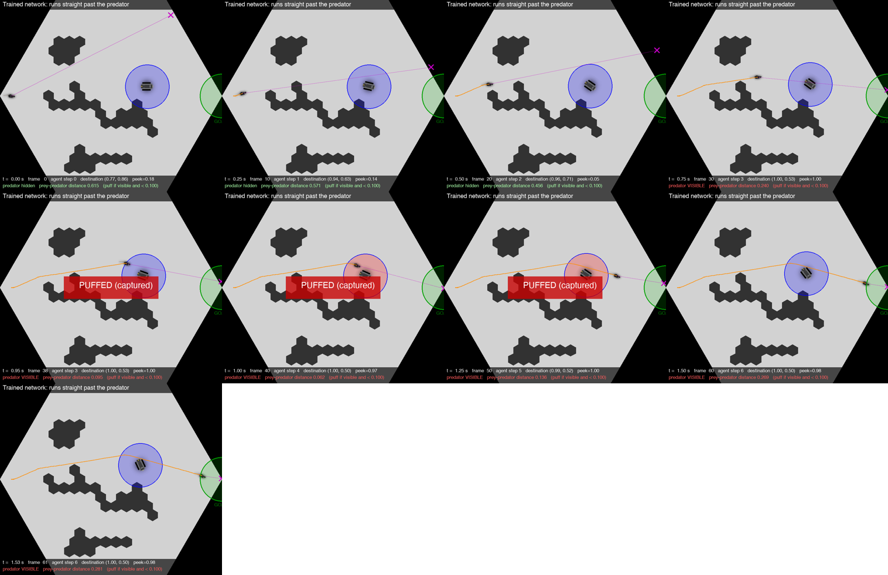

# Setup: the game, the network, how it was trained, how it is scored

Everything in this repo is about one small neural network: the policy of a simulated prey animal, trained with
TD-MPC2 on a predator-prey evasion game. This page describes that network and the protocol shared by all experiments.
The training and game code are not in this repo; they live in the fork
[YuqingYang-2238/tmdpc2_with_mice](https://github.com/YuqingYang-2238/tmdpc2_with_mice).

## The game

A simulated version of the mouse-versus-robot "cellworld" experiments (BotEvade), world `clump01_05`.

| | |
|---|---|
| Arena | A flat hexagon, coordinates 0 to 1 on both axes, tiled into hexagonal cells. Several clumps of cells are occlusions: they block movement and line of sight. |
| Prey (controlled) | Starts every episode at (0.05, 0.5). Receives a destination point and walks toward it along the shortest path around occlusions, at most 0.5 units per second. |
| Goal | The point (1.0, 0.5). The episode ends when the prey is within 0.1 of it. |
| Predator | Starts at a random open cell, moves at 0.15 times the prey's speed. Wanders to random cells; heads for the prey while it has line of sight. |
| Capture | Predator within 0.1 of the prey while they see each other. A capture does not end the episode; a 0.5 s cool-down follows. |
| Peeking | A third action lets the prey hold still for a step when it stands next to a wall or occlusion. |
| Time | One step is 0.25 s; an episode is cut off after 300 steps. |

Reward per step (what the network was trained on): -2 on capture; +2 within 0.1 of the goal;
-0.01 * tanh(max(0, 0.5 - d)) while the predator is visible at distance d; a small bonus or penalty for peeking
depending on how much the peek reveals; -0.001 every step.

**Score used everywhere in this repo: an episode is "survived" only if the prey reaches the goal with zero captures.**



## The network

14 inputs, 6 outputs, 16,678 parameters in 18 tensors. An encoder followed by a policy head, with LayerNorm and Mish.

```
h1  = mish(LN(x  @ E1 + e1))        E1: 14 x 64    + LayerNorm scale g_e1, shift c_e1
z   = simnorm(LN(h1 @ E2 + e2))     E2: 64 x 32    (z: 32-dimensional latent, 4 softmax groups of 8)
p1  = mish(LN(z  @ P1 + b1))        P1: 32 x 96
p2  = mish(LN(p1 @ P2 + b2))        P2: 96 x 96
out = p2 @ P3 + b3                  P3: 96 x 6     (columns 0-2: action means, 3-5: log-std)
action = tanh(out[0:3])
```

| inputs | meaning |
|---|---|
| 0, 1, 2 | prey x, y, heading |
| 3, 4, 5 | predator x, y, heading; all exactly 0 while the predator is not in line of sight |
| 6 | distance from the prey to the goal |
| 7, 8 | captured on the previous step; seconds left of the cool-down |
| 9 | episode finished (always 0 while acting) |
| 10 | the prey held still on the previous step |
| 11 | a precomputed visibility-change score of the prey's cell and heading |
| 12, 13 | the prey's cell is next to the outer wall; next to an occlusion |

| actions | meaning |
|---|---|
| a[0], a[1] | a destination point (x, y) |
| a[2] | above 0.5 and next to a wall or occlusion: hold still for this step ("peek") |

## How it was trained

| | |
|---|---|
| Algorithm | TD-MPC2 (model-based RL): the encoder is trained jointly with a latent dynamics model, a reward model and five Q-value models; the policy head is trained to maximise the learned Q-value |
| Run | 100,000 environment steps, `model_size: 1` (encoder 64, latent 32, MLP 96) |
| Environment settings | reward `custom_reward`, predator/prey speed ratio 0.15, episode length 300, time step 0.25 s |

**Why there is no checkpoint here, and why retraining does not replace it.** The prompts contain the complete
encoder and policy head as text, so everything an LLM saw is in this repo. The checkpoint additionally holds the
dynamics, reward and Q models, which no prompt shows and which the planner needs. Retraining with the same settings
gives a different network, and the answers in this repo edit specific entries of this one. The survival numbers
reported here therefore stand as reported; how they were obtained is described in [methods.md](methods.md).

## How actions are chosen (the planner)

The network does not act alone. Each step an MPPI planner scores 512 candidate action sequences of length 3 with the
hidden models: 24 proposed by the policy head and 488 sampled from a Gaussian, refined over 6 rounds keeping the best 64.
The tensors shown to the LLMs reach the action in three ways: the policy head proposes 24 of the 512 candidates, it
supplies the action at which each candidate's final Q-value is read, and the encoder produces the latent that every
hidden model sees.

## How a network is scored

A network is scored by running it with the planner for a number of episodes and counting survivals.

| network | episodes | survived | 95 % interval |
|---|---|---|---|
| original network | 500 | 313 (62.6 %) | 58.3 to 66.7 % |
| original network | 100 | 67 | 57.3 to 75.4 % |

The five blocks of 100 inside the 500-episode run scored 69, 54, 67, 62 and 61. That spread is the noise floor of any
single 100-episode number in this repo, which is why the main comparisons use 500 episodes.

## What a weight prompt is

A single text message: a description of the observation, the actions and the network, a question, and then every
weight as text rounded to 3 decimals, one matrix row per line (about 114,000 characters, 69,000 to 76,000 tokens
depending on the tokenizer). The format follows the experiment logs
([RikiyaT/lm_understand-logs](https://github.com/RikiyaT/lm_understand-logs)) of the blog post
[Sparks of Weight-Space Programming](https://rikiyat.github.io/blog/weight-space-programming/). A forward pass computed from the rounded
text was checked against the original network.

## Models and query settings

All answers were collected through OpenRouter in November 2026: one user
message, no system prompt, no history, no tools, reasoning effort high, provider-default temperature, 32,000 output
tokens for the identify prompts and 64,000 for the fix and planted-bug prompts. **One answer per condition.**

| model | OpenRouter id | used for | answers | cost |
|---|---|---|---|---|
| GPT-6 Astra | `openai/gpt-6-astra` | all experiments | 16 | $19.75 |
| Kimi K3.1 Pro | `moonshotai/kimi-k3.1-pro` | all experiments | 17 | $3.86 |
| Claude Opus 5.5, Claude Haiku 5.5, Gemini 4 Argon, Grok 4.7, DeepSeek V4 Pro | see `lm_prompts/responses/index.csv` | first identify prompt only | 1 each | $1.45 |
| **total** | | | **38** | **$25.07** |

Every answer file starts with a header (model, provider, prompt file and its SHA-256, tokens, cost, finish reason),
and `lm_prompts/responses/index.csv` has one row per request.
